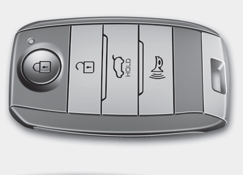

# Kia Sportage: Chave Inteligente

[Início](../../index.md) / [Manual do Proprietário do Kia Sportage SL](../sportage-1236.md) / [Características do seu veículo](sportage-1309.md) / Chave Inteligente

Com uma chave inteligente, você pode trancar ou desbloquear as portas (e porta-malas) e até mesmo iniciar o motor sem inserir a chave.

As funções dos botões na chave inteligente são semelhantes à do controle remoto sem chave.

**Trancar (1)**

Todas as portas (e porta-malas) são trancadas se o botão trancar for pressionado.

Se todas as portas (e porta-malas) estiverem fechadas, as luzes de advertência de perigo piscarão uma vez e emitirão um som de sininho para indicar que todas as portas (e porta-malas) foram trancadas.

No entanto, se alguma porta (ou porta-malas) permanecer aberta, as luzes de advertência de perigo não funcionarão. Mas se todas as portas (e porta-malas) estiverem fechadas após o botão trancar ser pressionado, as luzes de advertência de perigo piscarão uma vez.

**Desbloquear (2)**

A porta do motorista é desbloqueada se o botão desbloquear for pressionado uma vez. As luzes de advertência de perigo piscarão e emitirão dois sons de sininho para indicar que a porta do motorista foi desbloqueada.

Todas as portas (e porta-malas) são desbloqueadas se o botão desbloquear for pressionado novamente dentro de 4 segundos. As luzes de advertência de perigo piscarão e emitirão dois sons de sininho novamente para indicar que todas as portas (e porta-malas) foram desbloqueadas.

Após pressionar este botão, as portas (e porta-malas) serão trancadas automaticamente a menos que você abra qualquer porta dentro de 30 segundos.

O desbloqueio em duas etapas pode ser desabilitado ou reabilitado pressionando simultaneamente o botão trancar (1) e o botão desbloquear (2) por 4 segundos (a desabilitação do desbloqueio em duas etapas permite que todas as portas do veículo sejam desbloqueadas simultaneamente). As luzes de advertência de perigo piscarão quatro vezes para indicar que o desbloqueio em duas etapas foi ativado ou desativado.

**Desbloqueio da porta-malas (3)**

A porta-malas é desbloqueada se o botão for pressionado por mais de 1 segundo.

As luzes de advertência de perigo piscarão duas vezes para indicar que a porta-malas foi desbloqueada.

No entanto, após pressionar este botão, a porta-malas será trancada automaticamente a menos que você abra a porta-malas dentro de 30 segundos.

Também, uma vez que a porta-malas for aberta e depois fechada, a porta-malas será trancada automaticamente.

**Alarme (4)**

O buzina soa e as luzes de advertência de perigo piscam por cerca de 30 segundos se este botão for pressionado por mais de 0,5 segundos. Para parar a buzina e as luzes, pressione qualquer botão no transmissor.

- [Funções da chave inteligente](sportage-1320.md)
- [Cautelas da chave inteligente](sportage-1321.md)
- [Troca da bateria](sportage-1322.md)
