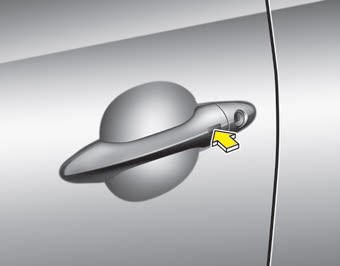

# Kia Sportage: Funções da chave inteligente

[Home](../../index.md) / [Manual do proprietário do Kia Sportage SL](../sportage-1236.md) / [Características do seu veículo](sportage-1309.md) / [Chave inteligente](sportage-1319.md) / Funções da chave inteligente

Carregando a chave inteligente, você pode trancar e desbloquear as portas do veículo (e porta-malas). Também pode iniciar o motor. Consulte o seguinte para mais detalhes.

**Trancar**

Pressionando o botão das alças de porta externa dianteira com todas as portas (e porta-malas) fechadas e qualquer porta desbloqueada, trancará todas as portas (e porta-malas). As luzes de advertência piscam e o sininho soa uma vez para indicar que todas as portas (e porta-malas) estão trancadas.

O botão só funcionará quando a chave inteligente estiver a uma distância de 0,7~1 m (28~40 in.) da alça de porta externa. Se você quiser ter certeza de que uma porta foi trancada ou não, deve verificar o botão de trancamento de porta dentro do veículo ou puxar a alça de porta externa.

Mesmo que você pressione o botão, as portas não serão trancadas e o sininho soará por 3 segundos se qualquer uma das seguintes condições ocorrer:

- A chave inteligente estiver no veículo.
- O botão DE INÍCIO/PARADA DO MOTOR estiver na posição ACC ou ON.
- Qualquer porta, exceto a porta-malas, estiver aberta.

**Desbloquear**

Pressionando o botão da alça de porta externa do motorista com todas as portas (e porta-malas) fechadas e trancadas, desbloqueará a porta do motorista. As luzes de advertência piscam e o sininho soa duas vezes para indicar que a porta do motorista foi desbloqueada. Todas as portas (e porta-malas) serão desbloqueadas se o botão for pressionado novamente dentro de 4 segundos. As luzes de advertência piscarão e o sininho soará duas vezes para indicar que todas as portas (e porta-malas) foram desbloqueadas.

Pressionando o botão da alça de porta externa do passageiro dianteiro com todas as portas (e porta-malas) fechadas e trancadas, desbloqueará todas as portas (e porta-malas). As luzes de advertência piscam e o sininho soa duas vezes para indicar que todas as portas (e porta-malas) foram desbloqueadas.

O botão só funcionará quando a chave inteligente estiver a uma distância de 0,7~1 m (28~40 in.) da alça de porta externa.

Quando a chave inteligente for reconhecida na área de 0,7~1 m (28~40 in.) da alça de porta externa dianteira, outras pessoas também podem abrir a porta sem a posse da chave inteligente.

**Desbloqueio da porta-malas**

Se você estiver a uma distância de 0,7~1 m (28~40 in.) da alça de porta-malas externa, com a chave inteligente em posse, o porta-malas será desbloqueado e aberto quando você pressionar o botão de controle da porta-malas.

As luzes de advertência piscarão duas vezes para indicar que o porta-malas foi desbloqueado.

Também, uma vez que o porta-malas for aberto e depois fechado, ele será trancado automaticamente.

**Iniciar**

Você pode iniciar o motor sem inserir a chave. Para informações detalhadas, consulte "Iniciando o motor com uma chave inteligente" na seção 5.
