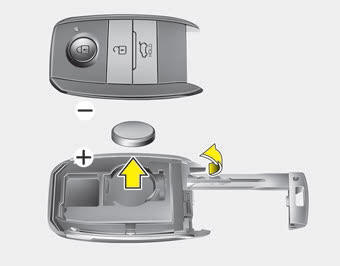

# Kia Sportage: Troca da bateria

[Home](../../index.md) / [Manual do proprietário Kia Sportage SL](../sportage-1236.md) / [Características do seu veículo](sportage-1309.md) / [Chave inteligente](sportage-1319.md) / Troca da bateria

A bateria da chave inteligente deve durar vários anos, mas se a chave inteligente não estiver funcionando corretamente, tente substituí-la por uma nova. Se você não souber como usar a chave inteligente ou substituir a bateria, entre em contato com um concessionário autorizado da Kia.

*NOTA*

*O circuito da chave inteligente pode ter um problema se exposto a umidade ou eletrostática. Se você não souber como usar a chave inteligente ou substituir a bateria, entre em contato com um concessionário autorizado da Kia.*

1. Remova a chave mecânica.

2. Abra a tampa traseira da chave inteligente usando um pincel.

3. Substitua a bateria por uma nova (CR2032). Ao substituir a bateria, certifique-se da posição correta.

4. Instale a bateria na ordem inversa à remoção.

*NOTA*

- *Usar a bateria errada pode causar problemas na chave inteligente. Certifique-se de usar a bateria correta.*
- *Circuitos da chave inteligente podem desenvolver problemas se caírem, estiverem expostos a umidade ou eletrostática.*
- *Se suspeitar que a sua chave inteligente pode ter sofrido algum dano, ou se achar que a sua chave inteligente não está funcionando corretamente, entre em contato com um concessionário autorizado da Kia.*

Uma bateria mal descartada pode ser prejudicial ao meio ambiente e à saúde humana.

Descarte a bateria de acordo com as leis ou regulamentos locais.

*AVISO*

*Este dispositivo atende aos padrões RSS sem licença do IC (Industry Canada).*

*A operação está sujeita às seguintes duas condições: (1) este dispositivo não deve causar interferência, e (2) este dispositivo deve aceitar qualquer interferência, incluindo interferências que possam causar operação indesejada do dispositivo.*
