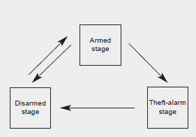

# Kia Sportage: Sistema antifurto

[Início](../../index.md) / [Manual do proprietário do Kia Sportage SL](../sportage-1236.md) / [Características do seu veículo](sportage-1309.md) / Sistema antifurto

Este sistema foi projetado para fornecer proteção contra entrada não autorizada no carro. Este sistema opera em três etapas: a primeira é a etapa "Ardil", a segunda é a etapa "Sinal de Furto" e a terceira é a etapa "Desarmada". Se acionado, o sistema fornece um alarme sonoro com piscada das luzes de advertência.

- [Etapa Ardil](sportage-1324.md)
- [Etapa Sinal de Furto](sportage-1325.md)
- [Etapa Desarmada](sportage-1326.md)
