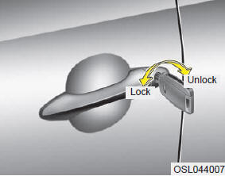
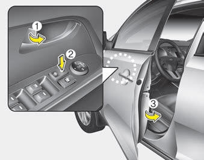

# Kia Sportage: Operar travas de porta externamente ao veículo

[Home](../../index.md) / [Manual do proprietário Kia Sportage SL](../sportage-1236.md) / [Características do seu veículo](sportage-1309.md) / [Travas de porta](sportage-1327.md) / Operar travas de porta externamente ao veículo

- Vire a chave no sentido horário para desbloquear e no sentido anti-horário para bloquear.
- Se você bloquear a porta do motorista com a chave, todas as portas do veículo também serão bloqueadas automaticamente.
- Da porta do motorista, vire a chave para a direita uma vez para desbloquear a porta
	e uma vez mais dentro de 4 segundos para desbloquear todas as portas.
- As portas também podem ser bloqueadas e desbloqueadas com o transmissor.
- Uma vez que as portas são desbloqueadas, elas podem ser abertas puxando o puxador da porta.
- Ao fechar a porta, empurre a porta à mão. Certifique-se de que as portas estejam fechadas
	e bem fechadas.

*✽ NOTA**

- *Em climas frios e úmidos, as travas de porta e as mecanismos das portas podem não funcionar
	corretamente devido às condições de congelamento.*
- *Se você bloquear/desbloquear a porta várias vezes em rápida sucessão com
	a chave do veículo ou o interruptor de travas de porta, o sistema pode parar temporariamente
	para proteger o circuito e prevenir danos aos componentes do sistema.*

- Para bloquear uma porta sem a chave, empurre o botão de travamento interno da porta (1) ou
	o interruptor central de travamento de porta (2) para a posição “Bloquear” e feche a porta (3).
- Se você bloquear a porta com o interruptor central de travamento de porta (2), todas as portas do veículo
	também serão bloqueadas automaticamente.

*✽ NOTA**

*Sempre retire a chave do ignição, engage o travamento de estacionamento, feche todas as janelas
	e bloqueie todas as portas quando deixar seu veículo desocupado.*
