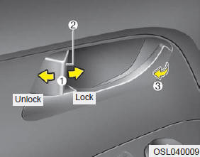

# Kia Sportage: Com o botão de travamento da porta

[Home](../../index.md) / [Manual do proprietário do Kia Sportage SL](../sportage-1236.md) / [Características do seu veículo](sportage-1309.md) / [Travamento das portas](sportage-1327.md) / [Operação das portas de travamento interno do veículo](sportage-1329.md) / Com o botão de travamento da porta

- Para desbloquear uma porta, pressione o botão de travamento da porta (1) para a posição “Desbloquear”. A marca vermelha (2) no botão será visível.
- Para bloquear uma porta, pressione o botão de travamento da porta (1) para a posição “Bloquear”. Se a porta estiver bloqueada corretamente, a marca vermelha (2) no botão de travamento da porta não será visível.
- Para abrir uma porta, puxe o puxador da porta (3) para fora.
- Se o puxador interno da porta do motorista (ou do passageiro do lado dianteiro) for puxado quando o botão de travamento da porta estiver na posição “Bloquear”, o botão desbloqueará e a porta abrirá. (se equipado)
- As portas dianteiras não podem ser bloqueadas se a chave do motor estiver no interruptor de ignição e qualquer porta dianteira for aberta.
- As portas não podem ser bloqueadas se a chave inteligente estiver no veículo e qualquer porta estiver aberta. (se equipado)

Se um travamento de porta elétrico falhar enquanto você estiver no veículo, tente uma ou mais das seguintes técnicas para sair:

- Operar repetidamente a função de desbloqueio da porta (ambos eletrônico e manual) enquanto puxa simultaneamente o puxador da porta.
- Operar os outros travamentos e puxadores, dianteiros e traseiros.
- Baixar uma janela dianteira e usar a chave para desbloquear a porta do lado de fora.
- Mover-se para a área de carga e abrir o porta-malas.
