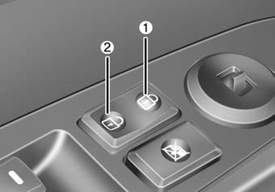
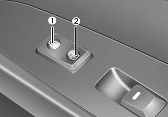

# Kia Sportage: Com interruptor central de travamento de porta

[Home](../../index.md) / [Manual do proprietário do Kia Sportage SL](../sportage-1236.md) / [Características do seu veículo](sportage-1309.md) / [Travamento de portas](sportage-1327.md) / [Operação do travamento de portas internamente](sportage-1329.md) / Com interruptor central de travamento de porta

Porta do motorista

Porta do passageiro

Operar pressionando o interruptor central de travamento de porta.

- Ao pressionar a parte frontal (1) do interruptor, todas as portas do veículo
	travarão.
- Ao pressionar a parte traseira (2) do interruptor, todas as portas do veículo
	desbloquearão.
- Se a chave estiver no interruptor de ignição e qualquer porta da frente for
	aberta, as portas não travarão mesmo que a parte frontal (1) do interruptor
中央门锁开关被按下。
- 当按压开关的前部（1）时，所有车辆门将上锁。
- 当按压开关的后部（2）时，所有车辆门将解锁。
- 如果钥匙在点火开关中且任何前门被打开，即使按压中央门锁开关的前部（1），门也不会上锁。
- 如果智能钥匙在车内且任何门被打开，即使按压中央门锁开关的前部（1），门也不会上锁。（如果配备）

AVISO - Portas

*As portas devem sempre estar completamente fechadas e travadas enquanto o veículo estiver em movimento para prevenir o acionamento acidental das portas.*

AVISO - Crianças/animais sem acompanhamento

*Nunca deixe crianças ou animais sem acompanhamento no seu veículo.*

*Um veículo fechado pode se tornar extremamente quente, causando morte ou ferimentos graves a crianças ou animais que não podem escapar do veículo.*
