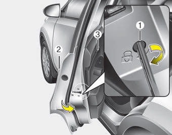

# Kia Sportage: Bloqueio de porta para proteção infantil

[Home](../../index.md) / [Manual do proprietário do Kia Sportage SL](../sportage-1236.md) / [Características do seu veículo](sportage-1309.md) / [Bloqueios das portas](sportage-1327.md) / Bloqueio de porta para proteção infantil

O bloqueio de segurança para crianças é fornecido para ajudar a prevenir que as crianças abram acidentalmente as portas traseiras do veículo por dentro. Os bloqueios de segurança das portas traseiras devem ser usados sempre que crianças estiverem no veículo.

1. Abra a porta traseira.

2. Insira a chave na abertura do bloqueio de segurança para crianças (1) e gire a chave para a posição bloqueada (  ). Quando o bloqueio de segurança para crianças estiver na posição bloqueada, a porta traseira não abrirá mesmo que a alavanca interna da porta seja puxada.

3. Feche a porta traseira.

Para abrir a porta traseira, puxe a alavanca externa da porta (2).

Mesmo que as portas estejam desbloqueadas, a porta traseira não abrirá ao puxar a alavanca interna da porta (3) até que o bloqueio de segurança das portas traseiras seja desbloqueado.

AVISO - Bloqueios das portas traseiras

*Use os bloqueios de segurança das portas traseiras sempre que crianças estiverem no veículo. Se uma criança acidentalmente abrir as portas traseiras enquanto o veículo estiver em movimento, ela pode cair fora.*
