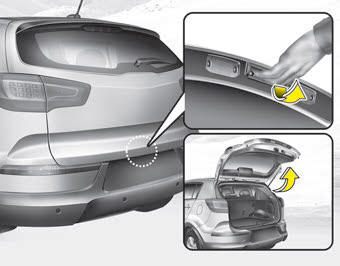

# Kia Sportage: Abertura do porta-malas

[Home](../../index.md) / [Manual do proprietário do Kia Sportage SL](../sportage-1236.md) / [Características do seu veículo](sportage-1309.md) / [Porta-malas](sportage-1336.md) / Abertura do porta-malas

- O porta-malas é trancado ou desbloqueado quando todas as portas são trancadas ou desbloqueadas
	com a chave, transmissor (ou chave inteligente) ou interruptor de travamento central.
- Se desbloqueado, o porta-malas pode ser aberto pressionando o interruptor do puxador e
	seguidamente puxando o puxador para cima.
- Apenas o porta-malas é desbloqueado se o botão de desbloqueio do porta-malas na chave inteligente
	for pressionado (se equipado). Uma vez que o porta-malas for aberto e depois fechado, o porta-malas
	será trancado automaticamente.

*✽ NOTA**

*Em climas frios e úmidos, os mecanismos de travamento das portas e das portas podem não funcionar corretamente
devido às condições de congelamento.*

O porta-malas se move para cima. Certifique-se de que não há objetos ou pessoas perto do fundo do veículo
quando abrir o porta-malas.

CAUTION - Abertura do porta-malas

*Certifique-se de que você feche o porta-malas antes de dirigir o veículo. Pode ocorrer
danos ao cilindro de elevação do porta-malas e ao equipamento adjacente se o porta-malas
não for fechado antes de dirigir.*
