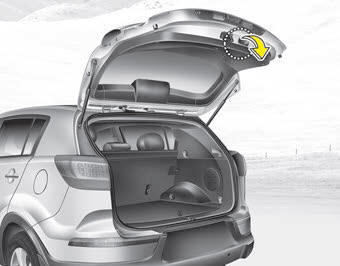

# Kia Sportage: Fechando o porta-malas

[Home](../../index.md) / [Manual do proprietário do Kia Sportage SL](../sportage-1236.md) / [Características do seu veículo](sportage-1309.md) / [Porta-malas](sportage-1336.md) / Fechando o porta-malas

Para fechar o porta-malas, abaixe e empurre firmemente o porta-malas. Certifique-se de que o porta-malas esteja seguramente travado.

Certifique-se de que suas mãos, pés e outras partes do seu corpo estejam fora do caminho antes de fechar o porta-malas.

CAUTION

*Certifique-se de que nada esteja perto do travamento e do impactador do porta-malas ao fechá-lo. Isso pode danificar o travamento do porta-malas.*

WARNING - Fumaças de escape

*Não é recomendável dirigir com o porta-malas aberto. Fumaças perigosas podem entrar no compartimento de passageiros. Se você tiver que dirigir com o porta-malas aberto, mantenha os ventiladores de ar e todas as janelas abertas para que o ar externo adicional possa entrar.*

WARNING - Área de carga traseira

*Nunca deixe passageiros na área de carga traseira onde não estão disponíveis sistemas de retenção. Os passageiros devem estar sempre adequadamente retenidos.*
