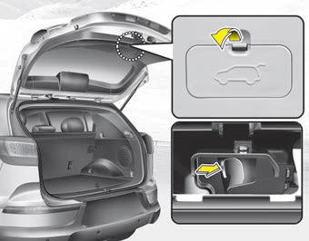

# Kia Sportage: Lanço de segurança de travamento de porta-tranque

[Início](../../index.md) / [Manual do proprietário do Kia Sportage SL](../sportage-1236.md) / [Características do seu veículo](sportage-1309.md) / [Porta-tranque](sportage-1336.md) / Lanço de segurança de travamento de porta-tranque

Seu veículo está equipado com um lanço de segurança de travamento de porta-tranque localizado
no fundo da porta-tranque. Quando alguém é acidentalmente travado na área de carga, a porta-tranque pode ser aberta empurrando o lanço de segurança e empurrando a porta-tranque para abrir.

AVISO

- *Ninguém deve ser permitido a ocupar a área de carga do veículo em qualquer
	tempo. A área de carga é uma localização muito perigosa em caso de colisão.*
- *Use o lanço de segurança apenas em emergências. Use com extrema cautela,
	especialmente enquanto o veículo estiver em movimento.*
