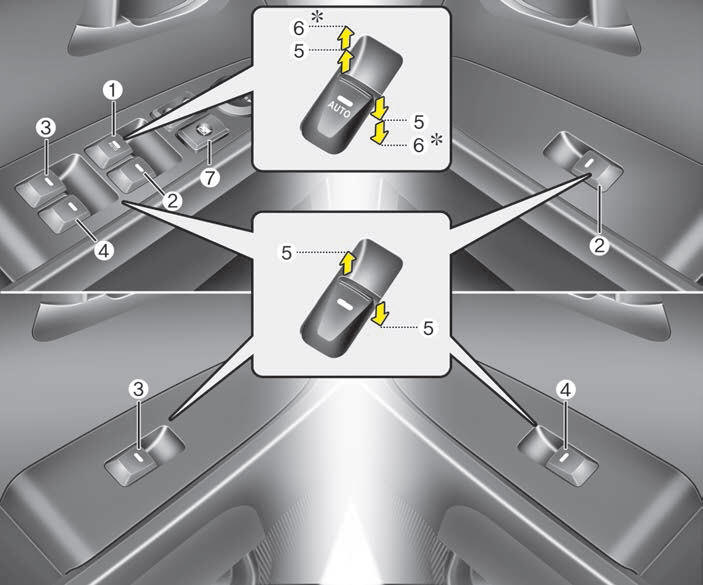

# Kia Sportage: Janelas

[Home](../../index.md) / [Manual do Proprietário Kia Sportage SL](../sportage-1236.md) / [Características do seu veículo](sportage-1309.md) / Janelas

(1) Interruptor de janela elétrica da porta do motorista

(2) Interruptor de janela elétrica da porta do passageiro do banco dianteiro

(3) Interruptor de janela elétrica da porta traseira (esquerda)

(4) Interruptor de janela elétrica da porta traseira (direita)

(5) Abertura e fechamento da janela

(6) Subida/descida automática da janela elétrica (janela do motorista)

(7) Interruptor de bloqueio da janela elétrica

Em climas frios e úmidos, as janelas elétricas podem não funcionar corretamente devido às condições de congelamento.

- [Janelas elétricas](sportage-1341.md)
