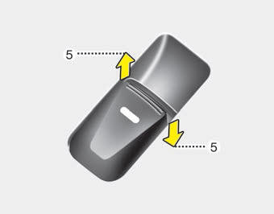
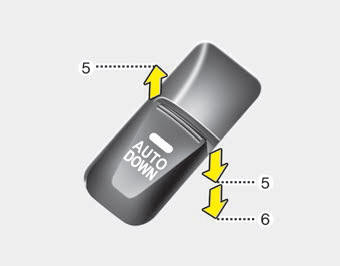
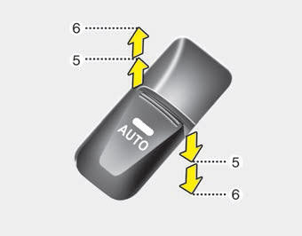
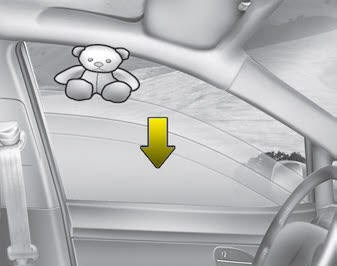

# Kia Sportage: Abertura e fechamento das janelas

[Home](../../index.md) / [Manual do proprietário do Kia Sportage SL](../sportage-1236.md) / [Características do seu veículo](sportage-1309.md) / [Janelas](sportage-1340.md) / [Janelas elétricas](sportage-1341.md) / Abertura e fechamento das janelas

**Tipo A**

A porta do motorista possui um interruptor principal de janela elétrica que controla todas as janelas do veículo.

Para abrir ou fechar uma janela, pressione a parte frontal do interruptor correspondente para a primeira posição de detent (5).

**Tipo B - Janela elétrica automática (Janela do motorista, se equipada)**

Pressionar o interruptor de janela elétrica por um breve momento na segunda posição de detent (6) faz com que a janela do motorista seja completamente baixada mesmo quando o interruptor é solto. Para parar a janela em uma posição desejada enquanto a janela está em operação, pressione momentaneamente o interruptor na direção oposta ao movimento da janela.

**Tipo C - Janela elétrica automática (Janela do motorista, se equipada)**

Pressionar ou puxar o interruptor de janela elétrica por um breve momento na segunda posição de detent (6) faz com que a janela seja completamente baixada ou levantada mesmo quando o interruptor é solto. Para parar a janela em uma posição desejada enquanto a janela está em operação, puxe ou pressione e solte o interruptor.

Se a janela elétrica não funcionar normalmente, o sistema de janela elétrica automática deve ser reiniciado conforme indicado:

1. Coloque o interruptor de ignição na posição ON.

2. Feche a janela do motorista e continue puxando o interruptor de janela elétrica do motorista por pelo menos 1 segundo após a janela estar completamente fechada.

**Reversão automática (Tipo C)**

Se o movimento de subida da janela for bloqueado por um objeto ou parte do corpo, a janela detectará a resistência e parará o movimento de subida. A janela então baixará aproximadamente 30 cm (11,8 in.) para permitir que o objeto seja removido.

A distância pode variar com base no tamanho ou posição da janela. Se a janela detectar a resistência enquanto o interruptor de janela elétrica estiver sendo puxado continuamente, a janela parará o movimento de subida e então baixará aproximadamente 2,5 cm (1 in.).

E se o interruptor de janela elétrica for puxado continuamente novamente dentro de 5 segundos após a janela ser baixada pela função de reversão automática, a função de reversão automática não funcionará.

A função de reversão automática para a janela do motorista está ativa apenas quando a função "auto up" for usada puxando completamente o interruptor. A função de reversão automática não funcionará se a janela for levantada usando a posição intermediária do interruptor de janela elétrica.

AVISO

*Sempre verifique para obstruções antes de levantar qualquer janela para evitar ferimentos ou danos ao veículo. Se um objeto com diâmetro inferior a 4 mm (0,16 in.) estiver preso entre o vidro da janela e o canal superior da janela, a função de reversão automática da janela

não detectará a resistência e não parará e mudará de direção.*
