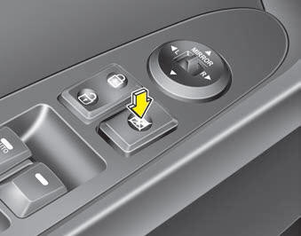

# Kia Sportage: Botão de bloqueio das janelas elétricas

[Início](../../index.md) / [Manual do proprietário do Kia Sportage SL](../sportage-1236.md) / [Características do seu veículo](sportage-1309.md) / [Janelas](sportage-1340.md) / [Janelas elétricas](sportage-1341.md) / Botão de bloqueio das janelas elétricas

O condutor pode desabilitar os interruptores das janelas elétricas nas portas do motorista e dos passageiros traseiros pressionando o interruptor de bloqueio das janelas elétricas para a posição de bloqueio (pressionado).

Quando o interruptor de bloqueio das janelas elétricas é pressionado, o controle mestre do motorista não pode operar as janelas elétricas dos passageiros dianteiros e traseiros.

CAUTION - Abertura / fechamento de janela

*Para prevenir danos possíveis ao sistema de janelas elétricas, não abra ou feche duas janelas ou mais ao mesmo tempo. Isso também assegurará a longevidade do fusível.*

WARNING - Janelas elétricas

*Não permita que crianças brinquem com as janelas elétricas. Manter o interruptor de bloqueio da janela elétrica da porta do motorista na posição LOCK (pressionado).*

Sempre verifique duas vezes para garantir que todos os braços, mãos, cabeça e outras obstruções estejam fora de perigo antes de fechar uma janela.
