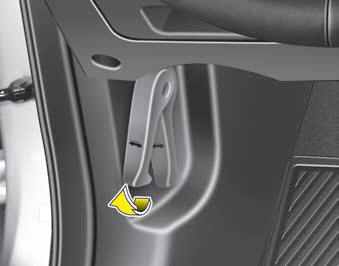
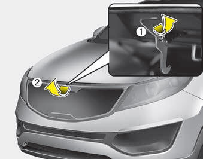
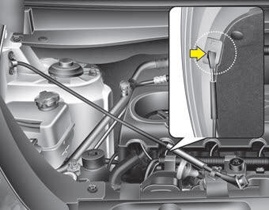

# Kia Sportage: Abertura do capô

[Home](../../index.md) / [Manual do proprietário do Kia Sportage SL](../sportage-1236.md) / [Características do seu veículo](sportage-1309.md) / [Capô](sportage-1344.md) / Abertura do capô

1. Empurre o gancho de liberação para soltar o capô. O capô deve se abrir levemente.

Abra o capô após desligar o motor em uma superfície plana, coloque o engrenamento do câmbio na posição P (Park) para transmissão automática e na posição 1ª (Primeira) ou R (Ré) para transmissão manual, e coloque o freio de estacionamento.

2. Vá para o lado da frente do veículo, levante o capô ligeiramente, puxe o gancho secundário (1) no centro do capô e levante o capô (2).

3. Retire a viga de apoio do suporte da viga.

4. Coloque a ponta da viga de apoio no orifício designado na parte inferior do capô para manter o capô levantado.

AVISO - Peças quentes

*Agarre a viga de apoio na área envolta em borracha. A borracha ajudará a prevenir que você seja queimado pelo metal quente quando o motor estiver quente.*
