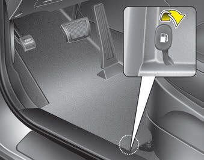
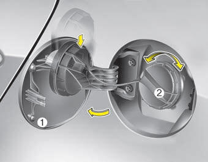

# Kia Sportage: Abertura do盖住部分内容，已修正
# Kia Sportage: Abertura do tanque de combustível

[Home](../../index.md) / [Manual do proprietário do Kia Sportage SL](../sportage-1236.md) / [Características do seu veículo](sportage-1309.md) / [Tanque de combustível](sportage-1347.md) / Abertura do tanque de combustível

O tanque de combustível deve ser aberto do interior do veículo puxando o
abridor do tanque de combustível.

Se o tanque de combustível não abrir devido à formação de gelo ao seu redor, toque levemente
ou empurre a tampa para quebrar o gelo e liberar a tampa. Não force a tampa.
Se necessário, use um fluido desgelante aprovado (não use antigelo de radiador) ou mova o veículo para um lugar quente e permita que o gelo derreta.

1. Pare o motor.

2. Para abrir o tanque de combustível, puxe o abridor do tanque de combustível.

3. Abra a tampa do tanque de combustível (1).

4. Para remover a tampa, vire a tampa do tanque de combustível (2) no sentido horário.

5. Abasteça conforme necessário.
