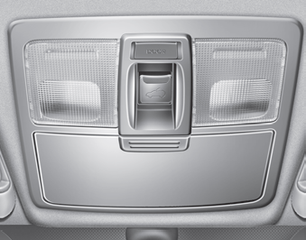

# Kia Sportage: Teto panorâmico

[Início](../../index.md) / [Manual do proprietário do Kia Sportage SL](../sportage-1236.md) / [Características do seu veículo](sportage-1309.md) / Teto panorâmico

Se o seu veículo estiver equipado com um teto panorâmico, você pode abrir ou inclinar o teto panorâmico usando o controle do teto localizado no console acima do volante (1).

O teto panorâmico só pode ser aberto, fechado ou inclinado quando o interruptor de ignição estiver na posição ON.

- [Chave de alerta de abertura do teto panorâmico](sportage-1351.md)
- [Abertura do teto panorâmico](sportage-1352.md)
- [Inclinação do teto panorâmico](sportage-1354.md)
- [Cortina de rolo](sportage-1355.md)
- [Reinicialização do teto panorâmico](sportage-1356.md)
