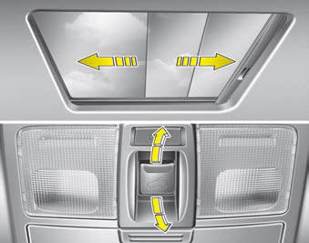

# Kia Sportage: Deslizando o telhado solar

[Home](../../index.md) / [Manual do proprietário do Kia Sportage SL](../sportage-1236.md) / [Características do seu veículo](sportage-1309.md) / [Telhado solar panorâmico](sportage-1350.md) / Deslizando o telhado solar

Antes de abrir ou fechar o telhado solar, abra o cobertor rolo (veja as instruções para usar o cobertor rolo na página seguinte).

Para abrir ou fechar o telhado solar (função de deslizamento manual), puxe ou empurre o lembrete do telhado solar para trás ou para frente até a primeira posição de detentor.

Puxar o lembrete do telhado solar para baixo também fecha o telhado solar.

Para abrir o telhado solar automaticamente:

Puxe o lembrete do telhado solar para trás até a segunda posição de detentor e, em seguida, solte-o. O telhado solar será aberto automaticamente.

Para parar o deslizamento do telhado solar em qualquer ponto, puxe ou empurre o lembrete do telhado solar momentaneamente.

Para fechar o telhado solar automaticamente:

Empurre o lembrete do telhado solar para frente até a segunda posição de detentor e, em seguida, solte-o. O telhado solar será fechado automaticamente.

Para parar o deslizamento do telhado solar em qualquer ponto, puxe ou empurre o lembrete do telhado solar momentaneamente.

- [Reversão automática](sportage-1353.md)
