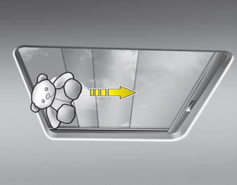

# Kia Sportage: Reversão Automática

[Home](../../index.md) / [Manual do Proprietário do Kia Sportage SL](../sportage-1236.md) / [Características do seu veículo](sportage-1309.md) / [Teto solar panorâmico](sportage-1350.md) / [Deslizando o teto solar](sportage-1352.md) / Reversão Automática

Se um objeto ou parte do corpo for detectado enquanto o teto solar estiver sendo fechado automaticamente, ele inverterá a direção e, em seguida, parará.

A função de reversão automática não funcionará se um pequeno obstáculo estiver entre o vidro deslizante e o batente do teto solar. Você deve sempre verificar que todos os passageiros e objetos estejam afastados do teto solar antes de fechá-lo.

AVISO - Operação do Teto Solar

*Ao fechar o teto solar, certifique-se de que não há partes do corpo no raio de movimento do teto deslizante. Partes do corpo poderiam ficar presas ou esmagadas.*
