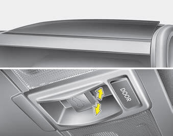

# Kia Sportage: Inclinando o teto-solar

[Início](../../index.md) / [Manual do proprietário do Kia Sportage SL](../sportage-1236.md) / [Características do seu veículo](sportage-1309.md) / [Teto-solar panorâmico](sportage-1350.md) / Inclinando o teto-solar

Antes de abrir ou fechar o teto-solar, abra o cobertor rolo (veja as instruções para usar o cobertor rolo na página seguinte).

Para abrir o teto-solar, empurre o leitor de teto-solar para cima.

Para fechar o teto-solar, puxe o leitor de teto-solar para baixo ou para frente até que o teto-solar se mova para a posição desejada.

Não estenda o rosto, o pescoço, os braços ou o corpo para fora do teto-solar ao dirigir.

ATENÇÃO - Danos ao motor do teto-solar

- *Para prevenir danos ao motor do teto-solar, remova periodicamente qualquer sujeira
	que possa acumular na guia.*
- *Se tentar abrir o teto-solar quando a temperatura estiver abaixo de zero
	ou quando o teto-solar estiver coberto de neve ou gelo, o vidro ou o motor podem
	ser danificados.*

Não deixe o cobertor rolo fechado enquanto o teto-solar estiver aberto.
