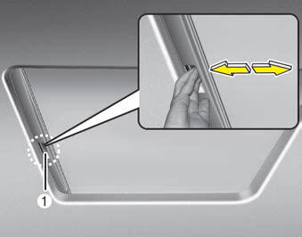

# Kia Sportage: Cortina Rolante

[Início](../../index.md) / [Manual do Proprietário do Kia Sportage SL](../sportage-1236.md) / [Características do seu veículo](sportage-1309.md) / [Teto solar panorâmico](sportage-1350.md) / Cortina Rolante

As cortinas rolantes estão instaladas dentro do teto solar e do teto de vidro.

Abra ou feche a cortina rolante manualmente usando o cabo (1) quando precisar.

Antes de abrir ou fechar o teto solar, abra a cortina rolante.

CAUTION - Cortina Rolante

*O uso da cortina rolante sem o cabo (1) pode causar alinhamento incorreto ou falha.*

*✽ NOTA*

*É normal que apareçam rugas na cortina devido às características do material.*
