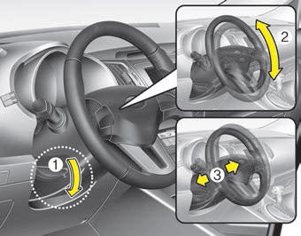

# Kia Sportage: Tilt steering/Telescópico

[Home](../../index.md) / [Manual do proprietário Kia Sportage SL](../sportage-1236.md) / [Características do seu veículo](sportage-1309.md) / [Volante](sportage-1357.md) / Tilt steering / Telescópico

O Tilt steering permite que você ajuste o volante antes de dirigir.

Você também pode elevar o volante para dar mais espaço às suas pernas ao entrar
e sair do veículo (se equipado).

O volante deve estar posicionado de forma que seja confortável para você dirigir,
permitindo que você veja as luzes de advertência e os indicadores do painel de instrumentos.

AVISO - Ajuste do volante

*Nunca ajuste o ângulo e a altura do volante ao dirigir. Você pode perder o controle do volante.*

Para mudar o ângulo do volante, puxe para baixo o puxador de liberação (1), ajuste
o volante para o ângulo desejado (2) e a altura (3, se equipado), depois puxe para cima o puxador de liberação para travar o volante em seu lugar. Certifique-se de ajustar o volante para a posição desejada antes de dirigir.

*✽ NOTA*

*Após o ajuste, às vezes o puxador de liberação não travará o volante. Não é uma falha. Isso ocorre quando dois engrenagens se engatam. Neste caso, ajuste o volante novamente e então trave o volante.*
