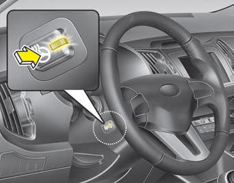

# Kia Sportage: Volante aquecido

[Home](../../index.md) / [Manual do proprietário do Kia Sportage SL](../sportage-1236.md) / [Características do seu veículo](sportage-1309.md) / [Volante](sportage-1357.md) / Volante aquecido

Com o botão ENGINE START/STOP na posição ON, pressionando o botão de volante aquecido aquece o volante. O indicador no botão ficará iluminado.

Para desligar o volante, pressione o botão novamente. O indicador no botão se apagará.

Ele se apagará automaticamente aproximadamente 30 minutos após o aquecimento do volante ser ativado.

Se a ignição for desligada e depois ligada novamente dentro de 30 minutos após o aquecimento do volante ser ativado, o sistema será automaticamente ativado novamente.

CAUÇÃO

- *Não instale um guia de volante aftermarket no volante. Isso pode causar danos ao sistema de volante aquecido.*
- *Ao limpar o volante aquecido, não use um solvente orgânico como tinta, benzeno, álcool e gasolina. Isso pode danificar a superfície do volante.*
- *Se a superfície do volante for danificada por um objeto afiado, danos aos componentes do volante aquecido podem ocorrer.*
