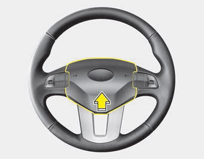

# Kia Sportage: Corneta

[Início](../../index.md) / [Manual do proprietário do Kia Sportage SL](../sportage-1236.md) / [Características do seu veículo](sportage-1309.md) / [Volante](sportage-1357.md) / Corneta

Para tocar a corneta, pressione as símbolos da corneta no seu volante. Verifique a corneta
regularmente para garantir que ela funcione corretamente.

*✽ NOTA DE SEGURANÇA*

*Para tocar a corneta, pressione a área indicada pelo símbolo da corneta no seu volante (veja a ilustração). A corneta funcionará apenas quando esta área for pressionada.*
