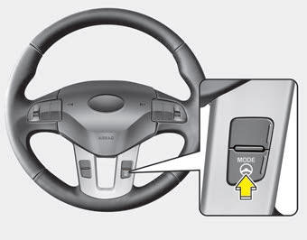
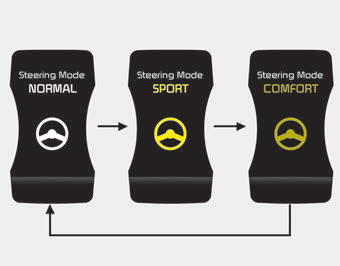

# Kia Sportage: FLEX Steer

[Início](../../index.md) / [Manual do proprietário do Kia Sportage SL](../sportage-1236.md) / [Características do seu veículo](sportage-1309.md) / [Volante](sportage-1357.md) / FLEX Steer

O FLEX Steer controla o esforço do volante de acordo com a preferência do motorista ou as condições de tráfego.

Você pode selecionar o modo de direção desejado pressionando o botão FLEX Steer.

O FLEX Steer permanecerá no último modo selecionado quando ligar o motor.

Quando o botão de modo de volante é pressionado, o modo de direção selecionado aparecerá
no display LCD.

Se o botão de modo de volante for pressionado dentro de 4 segundos, o modo de direção
mudará conforme as imagens acima.

Se o botão de modo de volante não for pressionado por cerca de 4 segundos, o display LCD
mudará para a tela anterior.

- [Modo normal](sportage-1363.md)
- [Modo esportivo](sportage-1364.md)
- [Modo conforto](sportage-1365.md)
