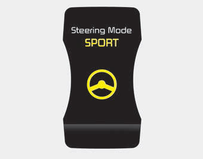

# Kia Sportage: Modo Desportivo

[Início](../../index.md) / [Manual do proprietário do Kia Sportage SL](../sportage-1236.md) / [Características do seu veículo](sportage-1309.md) / [Volante](sportage-1357.md) / [FLEX Steer](sportage-1362.md) / Modo Desportivo

O esforço de direção aumenta.
