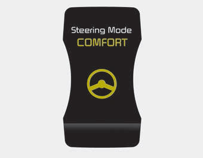

# Kia Sportage: Modo Comfort

[Início](../../index.md) / [Manual do Proprietário do Kia Sportage SL](../sportage-1236.md) / [Características do seu veículo](sportage-1309.md) / [Volante](sportage-1357.md) / [FLEX Steer](sportage-1362.md) / Modo Comfort

O esforço de direção fica mais leve no modo Comfort.

- Para sua segurança, se você pressionar o botão de modo de direção para mudar o modo
	enquanto girar o volante, a tela LCD irá mudar conforme selecionado,
	mas o esforço de direção não mudará. Após isso, se você deixar o volante centralizado,
	o esforço de direção mudará para o modo selecionado.
- Tenha cuidado ao mudar o modo de direção ao dirigir.
- Quando o assistente de direção eletrônico não estiver funcionando corretamente, o modo de direção selecionável pelo motorista não funcionará.
