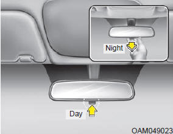

# Kia Sportage: Retrovisor diurno/nocturno

[Início](../../index.md) / [Manual do proprietário do Kia Sportage SL](../sportage-1236.md) / [Características do seu veículo](sportage-1309.md) / [Retrovisores](sportage-1366.md) / [Retrovisor interno](sportage-1367.md) / Retrovisor diurno/nocturno

Realize esta ajuste antes de iniciar a condução e enquanto o retrovisor diurno/nocturno estiver na posição diurna.

Puxe o retrovisor diurno/nocturno para você para reduzir o reflexo das luzes dos faróis dos veículos atrás durante a condução noturna.

Lembre-se de que você perde alguma clareza no retrovisor durante a posição nocturna.
