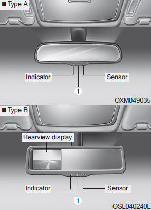

# Kia Sportage: Espelho Elétrico Electrochromático (EEM)

[Home](../../index.md) / [Manual do Proprietário Kia Sportage SL](../sportage-1236.md) / [Características do seu veículo](sportage-1309.md) / [Espelhos](sportage-1366.md) / [Espelho retrovisor interno](sportage-1367.md) / Espelho Elétrico Electrochromático (EEM)

O espelho retrovisor elétrico controla automaticamente a reflexão das luzes dos faróis
dos veículos que te seguem em condições de condução noturna ou com pouca luz. O sensor
instalado no espelho detecta o nível de luz ao redor do veículo e controla automaticamente
a reflexão das luzes dos faróis dos veículos que te seguem.

Quando o motor está em funcionamento, a reflexão é controlada automaticamente pelo sensor
instalado no espelho retrovisor.

Qualquer que seja a posição do selector de marchas (R), o espelho irá automaticamente
se ajustar para o nível de brilho máximo para melhorar a visibilidade do condutor atrás do veículo.

CAUTION - Limpeza do espelho

*Ao limpar o espelho, use um pano de papel ou material semelhante umedecido com limpador de vidros. Não molhe diretamente o espelho com limpador de vidros. Isso pode causar a entrada de líquido no corpo do espelho.*

Para operar o espelho retrovisor elétrico:

- O espelho estará no modo ON sempre que o interruptor do ignição for ligado.
- Pressione o botão ON/OFF (1) para desligar a função de diminuição automática. A luz indicadora do espelho se apagará.

	Pressione o botão ON/OFF (1) para ligar a função de diminuição automática. A luz indicadora do espelho se iluminará.

Se o seu veículo tiver tintura nas janelas ou outros tipos de revestimento metálico na janela traseira, o espelho retrovisor elétrico pode não funcionar corretamente.
