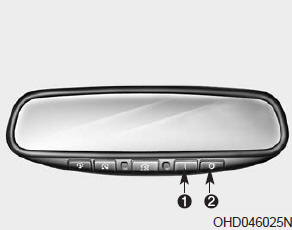
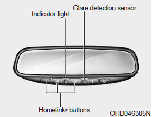
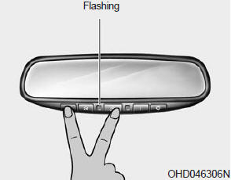
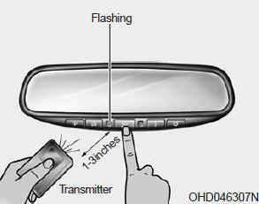
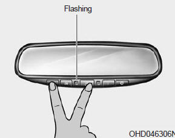

# Kia Sportage: Espelho elétrico com sistema HomeLink®

[Home](../../index.md) / [Manual do proprietário do Kia Sportage SL](../sportage-1236.md) / [Características do seu veículo](sportage-1309.md) / [Espelhos](sportage-1366.md) / [Espelho retrovisor interno](sportage-1367.md) / Espelho elétrico com sistema HomeLink®

Para operar o espelho retrovisor elétrico

Pressione o botão I (1) para ligar a função de ajuste automático e desbotamento. A luz indicadora do espelho será acesa.

Pressione o botão O (2) para desligar a função de ajuste automático e desbotamento. A luz indicadora do espelho será apagada.

Sistema de Controle Sem Fio HomeLink®

Seu novo espelho vem com um transmissor universal integrado HomeLink®, que permite programar o espelho para ativar sua porta de garagem, portão do quintal, iluminação da casa, etc. O espelho aprende os códigos dos seus transmissores existentes.

Preserve o transmissor original para procedimentos futuros de programação (por exemplo, compra de um novo veículo). É recomendado que, ao vender o veículo, os botões programados HomeLink® sejam apagados para fins de segurança (seguir o passo 1 na seção "Programação" deste texto).

**Programação**

Seu veículo pode exigir que a chave seja colocada no posição ACC para programar e/ou operar o HomeLink®. É recomendado que uma nova bateria seja substituída no transmissor portátil do dispositivo que será programado para HomeLink® para uma treinamento mais rápido e transmissão precisa da frequência radiofônica.

Siga estes passos para treinar seu espelho retrovisor HomeLink®:

1. Quando programando os botões pela primeira vez, pressione e segure os botões esquerdo e central ( 

,

) simultaneamente até que a luz indicadora comece a piscar após aproximadamente 20 segundos. (Este procedimento apaga os códigos padrão pré-programados. Não execute este passo para programar transmissores adicionais.)

*✽ NOTA*

*Para portas de garagem sem código de rolagem, siga os passos 2 - 3.

Para portas de garagem com código de rolagem, siga os passos 2 - 6.

Para programação canadense, siga a seção de programação canadense.

Para ajuda na determinação de se sua porta de garagem é sem código de rolagem ou com código de rolagem, consulte o manual do proprietário do transmissor de portas de garagem ou entre em contato com o serviço de atendimento ao cliente HomeLink® no 1-800-355-3515.*

2. Pressione e segure o botão no sistema HomeLink® que deseja treinar e o botão no transmissor enquanto o transmissor está a aproximadamente 2-8 cm (1 a 3 polegadas) de distância do espelho. Não solte os botões até que o passo 3 tenha sido concluído.

3. A luz indicadora do HomeLink® piscará, primeiro lentamente e depois rapidamente. Quando a luz indicadora piscar rapidamente, ambos os botões podem ser soltos. (A piscada rápida da luz indica o sucesso da programação da nova frequência.)

*✽ NOTA*

*Alguns portões eletrônicos e abradores de garagem podem exigir que você substitua o passo
#3 pelo procedimento de “cycling” mencionado na seção “Programação Canadense” deste documento.*

**Programação de código de rolagem**

Para treinar um abrador de garagem (ou outros dispositivos equipados com função de código de rolagem), siga estas instruções após concluir a seção “Programação” deste texto. (Uma segunda pessoa pode tornar o processo de treinamento mais rápido e fácil.)

4. Localize o botão “aprendizado” ou “inteligente” no módulo do motor do dispositivo. A localização exata e a cor do botão podem variar de acordo com a marca do produto. Se houver dificuldade em localizar o botão “aprendizado” ou “inteligente”, consulte o manual do usuário do dispositivo ou entre em contato com a HomeLink® no telefone 1-800-355-3515 ou no site <http://www.xn--homelink-8gh.com/>.

5. Pressione e solte o botão “aprendizado” ou “inteligente” no módulo do motor do dispositivo. Você tem 30 segundos para completar o passo 6.

6. Retorne ao veículo e pressione e solte o botão programado da HomeLink® até três vezes. O dispositivo equipado com código de rolagem deve reconhecer a sinalização da HomeLink® e ativá-la quando o botão da HomeLink® for pressionado. Os outros dois botões podem agora ser programados se isso ainda não tiver sido feito. Consulte a seção “Programação” deste texto.

**Operação da HomeLink®**

Para operar, basta pressionar o botão programado da HomeLink®. A ativação ocorrerá para o produto treinado (portão de garagem, sistema de segurança, trava de porta de entrada, portão de propriedade ou iluminação residencial ou comercial). Para conveniência, o transmissor portátil do dispositivo também pode ser usado a qualquer momento. O sistema de controle sem fio HomeLink® (após a programação) ou o transmissor portátil original podem ser usados para ativar o dispositivo (por exemplo, portão de garagem, trava de porta de entrada, etc.). Em caso de dificuldades de programação, entre em contato com a HomeLink® no telefone 1-800-355-3515 ou no site <http://www.xn--homelink-8gh.com/>.

**Exclusão dos botões programados da HomeLink®**

Para excluir os três botões programados (os botões individuais não podem ser excluídos):

• Pressione e segure simultaneamente os botões à esquerda e central por aproximadamente 20 segundos até que a luz indicadora comece a piscar. Solte ambos os botões. Não segure por mais de 30 segundos.

A HomeLink® agora está no modo de aprendizado (ou treinamento) e pode ser programada a qualquer momento.

**Programação de um único botão HomeLink®**

Para programar um dispositivo para a HomeLink® usando um botão HomeLink® anteriormente treinado, siga estes passos:

1. Pressione e segure o botão HomeLink® desejado. Não solte até que o passo 4 tenha sido concluído.

2. Quando a luz indicadora começar a piscar lentamente (após 20 segundos), posicione o transmissor portátil a uma distância de 2 a 8 cm (1 a 3 polegadas) do superfície da HomeLink®.

3. Pressione e segure o botão do transmissor portátil (ou pressione e “cycling” - conforme descrito na seção “Programação Canadense” acima).

4. A luz indicadora da HomeLink® piscará inicialmente lentamente e depois rapidamente. Quando

a luz indicadora começa a piscar rapidamente, solte ambos os botões.

O dispositivo anterior foi agora apagado e o novo dispositivo pode ser ativado pressionando o botão HomeLink® que acabou de ser programado. Este procedimento não afetará nenhum outro botão HomeLink® programado.

**Programação do portão eletrônico & programação canadense**

Durante a programação, seu transmissor portátil pode parar automaticamente de transmitir. Continue pressionando e segurando o botão HomeLink® (note os passos 2 a 4 na seção "Programação" deste texto) enquanto você pressiona e re-preSSIONA ("ciclo") seu transmissor portátil a cada dois segundos até que a frequência tenha sido aprendida. A luz indicadora piscará lentamente e rapidamente após alguns segundos com sucesso.

**Acessórios**

Se você deseja mais informações sobre o sistema de controle sem fio HomeLink®, produtos compatíveis HomeLink® ou para comprar outros acessórios, como o Pacote de Iluminação HomeLink®, entre em contato com o HomeLink® no telefone 1-800-355-3515 ou no site www.homelink®.com.

**Este dispositivo atende ao padrão Industry Canada RSS-210.**

A operação está sujeita às seguintes duas condições:

1. Este dispositivo não pode causar interferência prejudicial,

2. Este dispositivo deve aceitar qualquer interferência recebida, incluindo interferências que possam causar operação indesejada.

O transmissor HomeLink® foi testado e atende às regras da FCC e do Industry Canada. Mudanças ou modificações não expressamente aprovadas pelo responsável pela conformidade podem anular a autorização do usuário para operar o equipamento.

IC: 4112104541A Gentex

MODELO/FCC ID: NZLSTDHL3
