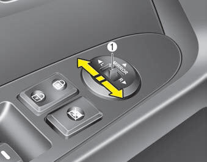

# Kia Sportage: Controle Remoto

[Home](../../index.md) / [Manual do proprietário do Kia Sportage SL](../sportage-1236.md) / [Características do seu veículo](sportage-1309.md) / [Réfrigeiradores](sportage-1366.md) / [Réfrigeirador externo](sportage-1371.md) / Controle Remoto

**Tipo Elétrico**

O interruptor do réfrigeirador elétrico permite ajustar a posição dos réfrigeiradores laterais externos. Para ajustar a posição de qualquer um dos réfrigeiradores, o interruptor do acendimento deve estar na posição ACC.

Mova o interruptor (1) para R ou L para selecionar o réfrigeirador da lateral direita ou esquerda, em seguida, pressione um ponto correspondente no controle de ajuste do réfrigeirador para posicionar o réfrigeirador selecionado para cima, para baixo, para a esquerda ou para a direita. Após o ajuste, coloque o interruptor na posição neutra (centro) para prevenir ajustes acidentais.

AVISO

- *Os réfrigeiradores param de se mover quando atingem os ângulos de ajuste máximo, mas o motor continua a funcionar enquanto o interruptor estiver pressionado. Não pressione o interruptor por mais tempo do que necessário, pois o motor pode ser danificado.*
- *Não tente ajustar o réfrigeirador externo manualmente. Fazer isso pode danificar os componentes.*
