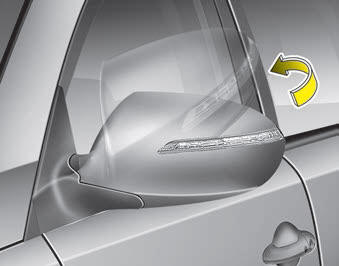
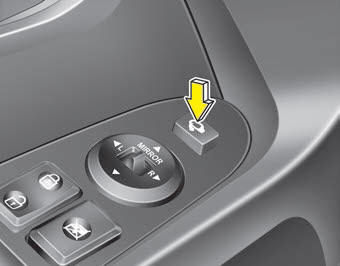

# Kia Sportage: Dobramento do espelho retrovisor externo

[Início](../../index.md) / [Manual do proprietário do Kia Sportage SL](../sportage-1236.md) / [Características do seu veículo](sportage-1309.md) / [Espelhos](sportage-1366.md) / [Espelho retrovisor externo](sportage-1371.md) / Dobramento do espelho retrovisor externo

**Tipo de manual (se equipado)**

Para dobrar o espelho retrovisor externo, segure a caixa do espelho e, em seguida, dobre-o para trás do veículo.

**Tipo elétrico (se equipado)**

Para dobrar o espelho retrovisor externo, pressione o botão.

Para desdobrá-lo, pressione o botão novamente.

AVISO - Espelho retrovisor externo elétrico

*O espelho retrovisor externo elétrico opera mesmo que a chave do veículo esteja no posição OFF. No entanto, para evitar a descarga desnecessária da bateria, não ajuste os espelhos por mais tempo do necessário quando o motor não estiver em funcionamento. Em caso de espelho retrovisor externo elétrico, não o dobre manualmente. Isso pode causar falha no motor.*
