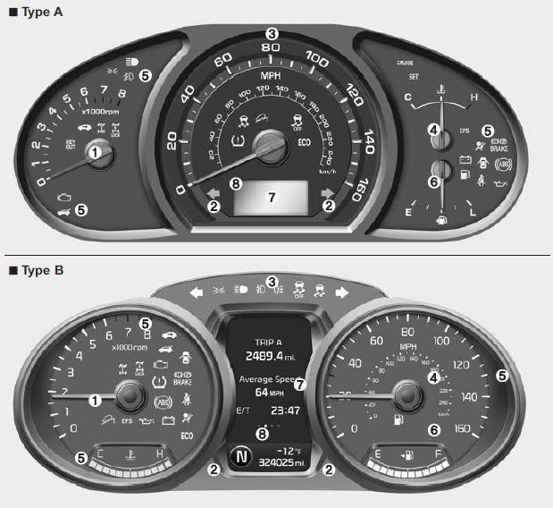

# Kia Sportage: Painel de instrumentos

[Home](../../index.md) / [Manual do proprietário do Kia Sportage SL](../sportage-1236.md) / [Características do seu veículo](sportage-1309.md) / Painel de instrumentos

1. Cronômetro

2. Indicadores de sinalização de mudança de direção

3. Cronômetro de velocidade

4. Cronômetro de temperatura do motor

5. Luzes de advertência e indicadores

6. Cronômetro de nível de combustível

7. Odômetro/Tripmeter*/Computador de bordo*

8. Indicador de posição do câmbio* (apenas para transmissão automática)

- [Illuminação do painel de instrumentos](sportage-1375.md)
- [Cronômetros](sportage-1376.md)
- [Advertências e indicadores](sportage-1382.md)
