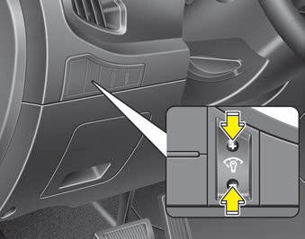

# Kia Sportage: Iluminação do painel de instrumentos

[Home](../../index.md) / [Manual do proprietário do Kia Sportage SL](../sportage-1236.md) / [Características do seu veículo](sportage-1309.md) / [Cluster de instrumentos](sportage-1374.md) / Iluminação do painel de instrumentos

Ao ligar o interruptor de ignição, pressione o botão de controle de iluminação para ajustar
a luminosidade da iluminação do painel de instrumentos.
