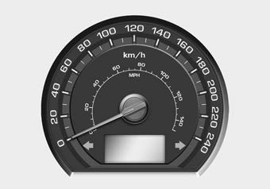
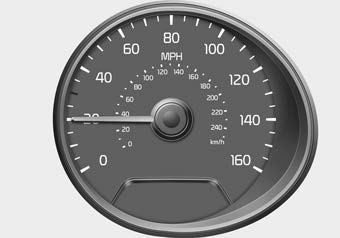

# Kia Sportage: Cronômetro

[Home](../../index.md) / [Manual do Proprietário Kia Sportage SL](../sportage-1236.md) / [Características do seu veículo](sportage-1309.md) / [Cluster de instrumentos](sportage-1374.md) / [Gauges](sportage-1376.md) / Cronômetro

Tipo A

Tipo B

O cronômetro indica a velocidade de avanço do veículo.

O cronômetro está calibrado em quilômetros por hora e/ou milhas por hora.
