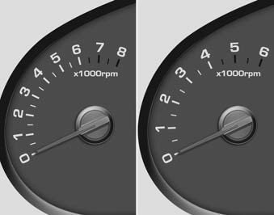

# Kia Sportage: Tachômetro

[Início](../../index.md) / [Manual do proprietário do Kia Sportage SL](../sportage-1236.md) / [Características do seu veículo](sportage-1309.md) / [Cluster de instrumentos](sportage-1374.md) / [Gauges](sportage-1376.md) / Tachômetro

O tachômetro indica o número aproximado de revoluções do motor por minuto (rpm).

Use o tachômetro para selecionar os pontos de troca de marcha corretos e para evitar o sobreaquecimento e/ou a sobrevolta do motor.

Quando a porta é aberta, ou se o motor não for ligado em 1 minuto, o indicador do tachômetro pode se mover levemente na posição ON com o motor desligado. Este movimento é normal e não afetará a precisão do tachômetro uma vez que o motor estiver em funcionamento.

CAUTION - Zona vermelha

*Não operar o motor dentro da zona vermelha do tachômetro. Isso pode causar danos graves ao motor.*
