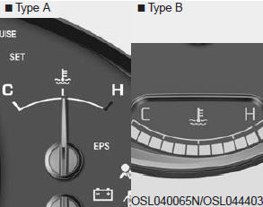

# Kia Sportage: Termômetro do motor

[Home](../../index.md) / [Manual do proprietário do Kia Sportage SL](../sportage-1236.md) / [Características do seu veículo](sportage-1309.md) / [Cluster de instrumentos](sportage-1374.md) / [Termômetros](sportage-1376.md) / Termômetro do motor

Este termômetro mostra a temperatura do líquido do motor quando o interruptor de
ignição estiver ligado.

Não continue dirigindo com motor aquecido. Se o seu veículo esquentar demais,
consulte "Se o motor esquentar demais" na seção 6.

Se o ponteiro do termômetro se mover além da área normal de funcionamento em direção à posição "H", isso indica aquecimento excessivo que pode danificar o motor.

AVISO - Radiador quente

*Nunca remova a tampa do radiador enquanto o motor estiver quente. O líquido do motor está sob pressão e pode causar queimaduras graves. Aguarde que o motor esfrie antes de adicionar líquido ao reservatório.*
