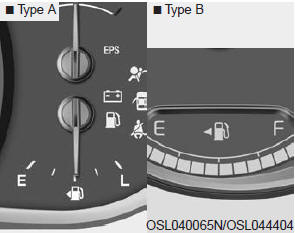

# Kia Sportage: Nível do tanque de combustível

[Início](../../index.md) / [Manual do proprietário do Kia Sportage SL](../sportage-1236.md) / [Características do seu veículo](sportage-1309.md) / [Cluster de instrumentos](sportage-1374.md) / [Gauges](sportage-1376.md) / Nível do tanque de combustível

O indicador de nível do tanque de combustível indica a quantidade aproximada de combustível restante no tanque. A capacidade do tanque de combustível está descrita na seção 8. O indicador de nível do tanque de combustível é complementado por uma luz de advertência de nível baixo, que se iluminará quando o tanque estiver quase vazio.

Em inclinações ou curvas, o ponteiro do indicador de nível do tanque de combustível pode oscilar ou a luz de advertência de nível baixo pode se acender mais cedo do que o normal devido ao movimento do combustível no tanque.

AVISO - Indicador de nível do tanque de combustível

*Parque e obtenha combustível adicional o mais rápido possível assim que a luz de advertência se acender ou quando o indicador se aproximar do nível E. Esgotar o combustível pode expor os ocupantes do veículo a perigos.*

CUIDADO - Nível baixo de combustível

*Evite dirigir com um nível de combustível extremamente baixo. Esgotar o combustível pode causar o motor a faltar, danificando o catalisador.*
