# Kia Sportage: Odômetro/Tripômetro/Computador de Viagem

[Home](../../index.md) / [Manual do Proprietário Kia Sportage SL](../sportage-1236.md) / [Características do seu veículo](sportage-1309.md) / [Cluster de instrumentos](sportage-1374.md) / [Gauges](sportage-1376.md) / Odômetro / Tripômetro / Computador de Viagem

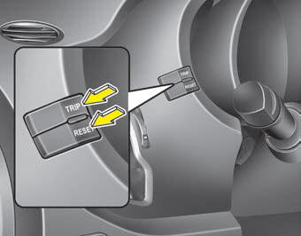

O computador de viagem é um sistema de informação para o condutor controlado por microcomputador que exibe informações relacionadas à condução, como odômetro, tripômetro, distância restante, velocidade média, tempo de condução, consumo médio de combustível e o indicador ECOMINDERTM (modo ECO ON/OFF) quando o interruptor de ignição está na posição ON. Todas as informações de condução armazenadas (exceto odômetro e distância restante) são redefinidas se a bateria for desligada.

O odômetro é sempre exibido até que a exibição seja desligada.

Pressione o botão TRIP para selecionar qualquer modo conforme indicado:

**Modos de Viagem (Tipo A)**

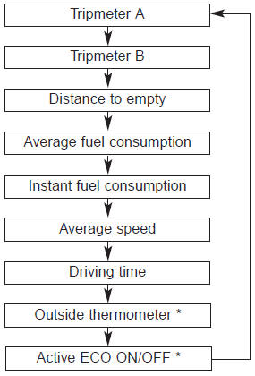

**Modos de Viagem (Tipo B)**

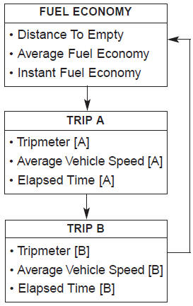

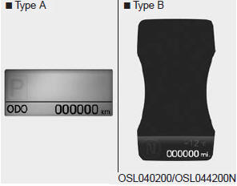

**Odômetro**

O odômetro indica a distância total percorrida pelo veículo.

Você também encontrará útil o odômetro para determinar quando deve ser realizada a manutenção periódica.

Veja Manutenção, seção 7.

*✽ NOTA*

É ilegal alterar o odômetro de todos os veículos com a intenção de mudar a quilometragem registrada no odômetro. A alteração pode anular a cobertura da garantia.

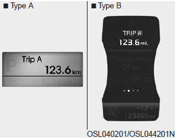

**Tripômetro**

TRIP A : Tripômetro A

TRIP B : Tripômetro B

Este modo indica a distância de viagens individuais selecionadas desde a última redefinição do tripômetro.

O intervalo de trabalho do relógio é de 0,0 a 999,9 km (0,0 a 999,9 milhas). Pressionando o botão RESET quando o tripômetro (TRIP A ou TRIP B) estiver sendo exibido, zera o tripômetro para zero (0,0).

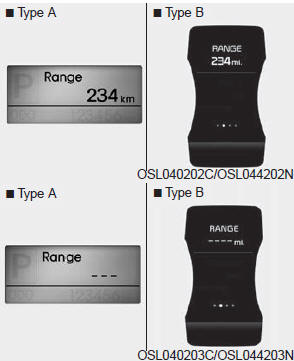

**Distância restante (km ou mi.)**

Este modo indica a distância estimada restante com base no combustível atual no tanque de combustível e a quantidade de combustível fornecida ao motor. Quando a distância restante é inferior a 50 km (30 milhas), "---" será exibido e o indicador de distância restante (RANGE) piscará até que o veículo seja reabastecido.

O intervalo de trabalho do relógio é de 50 a 990 km (30 a 990 milhas).

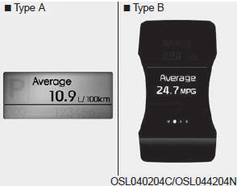

**Consumo médio de combustível (l/100 km ou MPG)**

Este modo calcula o consumo médio de combustível a partir do combustível total usado e da distância desde a última redefinição do consumo médio. A quantidade total de combustível usado é calculada a partir da entrada de consumo de combustível. Para um cálculo preciso, conduza mais de 50 m (0,03 milhas).

Pressionando o botão RESET por mais de 1 segundo quando o consumo médio de combustível estiver sendo exibido, zera o consumo médio de combustível para zero (--.-).

Se a velocidade do veículo exceder 1 km/h (1,6 MPH) após o reabastecimento de mais de 6 l (1,6 galões), o consumo médio de combustível será zera para zero (--.-).

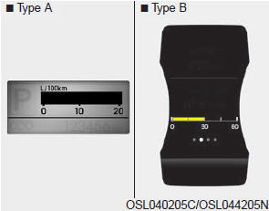

**Consumo instantâneo de combustível (se equipado) (l/100 km ou MPG)**

Este modo calcula o consumo instantâneo de combustível nas últimas poucas segundos.

- Se o veículo não estiver em terreno plano ou a energia da bateria tiver sido interrompida,
	a função "Distância até esgotamento" pode não funcionar corretamente.

	O computador de viagem pode não registrar combustível adicional se menos de 6 litros (1,6
	galões) de combustível forem adicionados ao veículo.
- O consumo de combustível e a distância até esgotamento podem variar significativamente
	de acordo com as condições de direção, hábitos de direção e condição do veículo.
- A distância até esgotamento é uma estimativa da distância de viagem disponível.
	Esse valor pode diferir da distância de viagem disponível real.

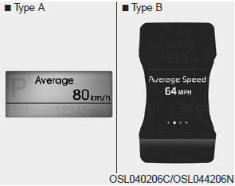

**Velocidade média (km/h ou MPH)**

Este modo calcula a velocidade média do veículo desde a última resetagem da velocidade média.

Mesmo que o veículo não esteja em movimento, a velocidade média continua a ser registrada enquanto o motor estiver funcionando.

Pressionar o botão RESET por mais de 1 segundo, quando a velocidade média estiver sendo exibida ou após o motor parar e 2 horas se passarem, zera a velocidade média para zero (--- ).

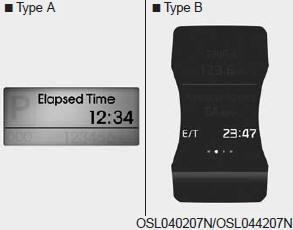

**Tempo de viagem**

Este modo indica o tempo total de viagem desde a última resetagem do tempo de viagem.

Mesmo que o veículo não esteja em movimento, o tempo de viagem continua a ser registrado enquanto o motor estiver funcionando.

O intervalo de trabalho do indicador está entre 0:00~99:59.

Pressionar o botão RESET por mais de 1 segundo, quando o tempo de viagem estiver sendo exibido ou após o motor parar e 2 horas se passarem, zera o tempo de viagem para zero (0:00).

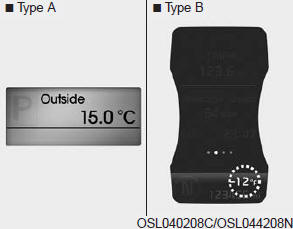

**Termômetro externo (se equipado)**

Este modo indica a temperatura externa ao redor do veículo.

O intervalo de trabalho do indicador está entre -40°C a 80°C (-40°F a 176°F).

Para mudar a unidade de exibição de temperatura (°C ↔ °F) :

- Para o Tipo A: Pressionar o botão RESET por mais de 1 segundo neste modo.

- Para o Tipo B: Pressionar o botão RESET 5 vezes e, em seguida, pressionar o botão TRIP 5 vezes dentro de 10 segundos.

• A temperatura externa exibida pode não mudar imediatamente como um termômetro geral
	para prevenir o condutor de ficar distraído.
