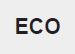

# Kia Sportage: Indicador ECOMINDER®

[Início](../../index.md) / [Manual do proprietário do Kia Sportage SL](../sportage-1236.md) / [Características do seu veículo](sportage-1309.md) / [Cluster de instrumentos](sportage-1374.md) / [Avisos e indicadores](sportage-1382.md) / Indicador ECOMINDER®

Sistema ECO ativo

Esta luz de indicador ilumina:

Quando o botão ECO ativo é pressionado, o indicador ECOMINDER® (verde) iluminará
para indicar que o ECO ativo está em operação.

Para informações mais detalhadas, consulte "ECO ativo" na seção 5.
