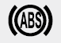
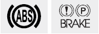

# Kia Sportage: Luz de sistema de freio de emergência (ABS)

[Home](../../index.md) / [Manual do proprietário Kia Sportage SL](../sportage-1236.md) / [Características do seu veículo](sportage-1309.md) / [Cluster de instrumentos](sportage-1374.md) / [Avisos e indicadores](sportage-1382.md) / Luz de sistema de freio de emergência (ABS)

Esta luz de aviso se ilumina se o interruptor de ignição estiver ligado e apaga-se
aproximadamente em 3 segundos se o sistema estiver operando normalmente.

Se a luz de ABS permanecer acesa, acender em viagem ou não acender quando o interruptor de ignição é colocado na posição ON, isso indica que o ABS pode ter apresentado um problema.

Neste caso, leve seu veículo a um concessionário autorizado da Kia o mais rápido possível para verificação. O sistema de freio normal ainda estará operacional, mas sem a assistência do sistema de freio de emergência.

Luz de distribuição eletrônica de força de freio (EBD)

Se essas duas luzes de aviso acenderem simultaneamente em viagem, o ABS e o sistema EBD podem ter apresentado um problema.

Neste caso, seu ABS e sistema de freios normais podem não funcionar normalmente. Leve o veículo a um concessionário autorizado da Kia o mais rápido possível para verificação.

AVISO - Luzes ABS/Freios

*Se ambas as luzes de ABS e freios estiverem acesas e permanecerem acesas, o sistema de freios do seu veículo não funcionará normalmente durante freios de emergência. Neste caso, evite dirigir a alta velocidade e freios bruscos. Leve o veículo a um concessionário autorizado da Kia o mais rápido possível.*

Se a luz de ABS ou a luz de EBD estiver acesa e permanecer acesa, o hodômetro ou o hodômetro/odômetro pode não funcionar. Além disso, a luz de indicador de assistência elétrica (EPS) pode acender e o esforço de direção pode aumentar ou diminuir. Neste caso, leve o veículo a um concessionário autorizado da Kia o mais rápido possível.
