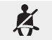

# Kia Sportage: Aviso do cinto de segurança

[Home](../../index.md) / [Manual do proprietário Kia Sportage SL](../sportage-1236.md) / [Características do seu veículo](sportage-1309.md) / [Cluster de instrumentos](sportage-1374.md) / [Avisos e indicadores](sportage-1382.md) / Aviso do cinto de segurança

Como uma lembrança ao motorista, o indicador do cinto de segurança piscará aproximadamente 6 segundos a cada vez que você ligar o chave de ignição, independentemente da fixação do cinto.

Se o cinto de segurança do motorista não estiver fixado quando a chave de ignição for ligada, o indicador do cinto de segurança e o zumbido do cinto de segurança funcionarão por aproximadamente 6 segundos. Mas se for fixado dentro dos 6 segundos, o indicador piscará até que os 6 segundos sejam completados. O zumbido será desligado imediatamente.

Se o cinto de segurança do motorista for desconectado após a chave de ignição ser ligada para a posição ON, o indicador do cinto de segurança piscará por aproximadamente 6 segundos. Mas se for fixado dentro dos 6 segundos, o indicador será desligado imediatamente. Se o cinto de segurança do motorista não estiver fixado quando a velocidade do veículo ultrapassar 10 km/h (6 mph), o indicador do cinto de segurança e o zumbido funcionarão aproximadamente 11 vezes com um padrão de 6 segundos ligados e 24 segundos desligados até que o cinto seja fixado ou a velocidade do veículo diminua para abaixo de 5 km/h (3 mph).

Para o indicador do cinto de segurança do assento do passageiro frontal na fascia central, consulte 'cinto' na seção 3.
