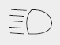

# Kia Sportage: Indicador de farol alto

[Home](../../index.md) / [Manual do proprietário do Kia Sportage SL](../sportage-1236.md) / [Características do seu veículo](sportage-1309.md) / [Cluster de instrumentos](sportage-1374.md) / [Avisos e indicadores](sportage-1382.md) / Indicador de farol alto

Este indicador ilumina quando os faróis estão ligados e na posição de farol alto
ou quando o botão do indicador de direção é puxado para a posição Flash-to-Pass.
