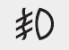

# Kia Sportage: Indicador de luzes de neblina dianteiras

[Início](../../index.md) / [Manual do proprietário do Kia Sportage SL](../sportage-1236.md) / [Características do seu veículo](sportage-1309.md) / [Cluster de instrumentos](sportage-1374.md) / [Avisos e indicadores](sportage-1382.md) / Indicador de luzes de neblina dianteiras

Este indicador ilumina quando as luzes de neblina dianteiras estiverem ligadas.
