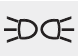

# Kia Sportage: Indicador de luz traseira

[Home](../../index.md) / [Manual do proprietário do Kia Sportage SL](../sportage-1236.md) / [Características do seu veículo](sportage-1309.md) / [Cluster de instrumentos](sportage-1374.md) / [Avisos e indicadores](sportage-1382.md) / Indicador de luz traseira

Este indicador ilumina quando as luzes traseiras estão ligadas.
