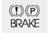

# Kia Sportage: Freio de estacionamento & advertência de nível de líquido freio

[Home](../../index.md) / [Manual do proprietário Kia Sportage SL](../sportage-1236.md) / [Características do seu veículo](sportage-1309.md) / [Cluster de instrumentos](sportage-1374.md) / [Advertências e indicadores](sportage-1382.md) / Freio de estacionamento & advertência de nível de líquido freio

**Advertência de freio de estacionamento**

Esta luz é acionada quando o freio de estacionamento é aplicado com o interruptor de ignição na posição START ou ON. A luz de advertência deve se apagar após alguns segundos quando o freio de estacionamento for liberado.

**Advertência de nível baixo de líquido freio**

Se a luz de advertência permanecer acesa, pode indicar que o nível de líquido freio no reservatório está baixo.

Se a luz de advertência permanecer acesa:

1. Dirija com cuidado para o local mais seguro possível e pare o veículo.

2. Com o motor parado, verifique imediatamente o nível de líquido freio e adicione o líquido necessário. Em seguida, verifique todos os componentes do freio para vazamentos.

3. Não dirija o veículo se forem encontrados vazamentos, a luz de advertência permanecer acesa ou os freios não funcionarem corretamente. Leve o veículo a qualquer concessionária autorizada da Kia para uma inspeção do sistema de freios e reparos necessários.

Seu veículo está equipado com sistemas de freio duplo-diagonal. Isso significa que você ainda tem freio em duas rodas mesmo se um dos sistemas duplos falhar. Com apenas um dos sistemas duplos funcionando, é necessário mais travessão normal do pedal e maior pressão do pedal para parar o veículo. Além disso, o veículo não parará em uma distância tão curta com apenas uma parte do sistema de freios funcionando. Se os freios falharem enquanto você estiver dirigindo, reduza para uma marcha inferior para freio de engrenagem adicional e pare o veículo assim que for seguro fazê-lo.

Para verificar a operação da lâmpada, verifique se a luz de freio de estacionamento e a advertência de nível de líquido freio acende quando o interruptor de ignição estiver na posição ON.

AVISO - Freio de estacionamento & Advertência de nível de líquido freio

*Dirigir o veículo com a luz de advertência acesa é perigoso. Se a luz de advertência de freios permanecer acesa, faça a verificação e reparo imediatos em uma concessionária autorizada da Kia.*
