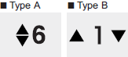
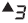
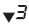

# Kia Sportage: Indicador de troca manual da transmissão

[Início](../../index.md) / [Manual do proprietário do Kia Sportage SL](../sportage-1236.md) / [Características do seu veículo](sportage-1309.md) / [Cluster de instrumentos](sportage-1374.md) / [Avisos e indicadores](sportage-1382.md) / Indicador de troca manual da transmissão

Este indicador informa qual engrenagem é desejada ao dirigir para economizar combustível.

Por exemplo

: Indica que a troca para a 3ª engrenagem é desejada (atualmente, o manopla de troca de marcha está na 2ª marcha).

Indica que a troca para a 3ª engrenagem é desejada (atualmente, o manopla de troca de marcha está na 4ª marcha).

*✽ NOTA*

*Quando o sistema não está funcionando corretamente, as setas de subida e descida e a engrenagem não são exibidas.*
