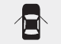

# Kia Sportage: Luz de advertência de porta aberta

[Início](../../index.md) / [Manual do proprietário do Kia Sportage SL](../sportage-1236.md) / [Características do seu veículo](sportage-1309.md) / [Cluster de instrumentos](sportage-1374.md) / [Advertências e indicadores](sportage-1382.md) / Luz de advertência de porta aberta

Esta luz de advertência acende quando uma porta não estiver fechada de maneira segura em qualquer posição do interruptor do acionamento da ignição.
