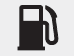

# Kia Sportage: Aviso de nível baixo de combustível

[Início](../../index.md) / [Manual do proprietário do Kia Sportage SL](../sportage-1236.md) / [Características do seu veículo](sportage-1309.md) / [Cluster de instrumentos](sportage-1374.md) / [Avisos e indicadores](sportage-1382.md) / Aviso de nível baixo de combustível

Este aviso indica que o tanque de combustível está quase vazio. Quando ele acender,
você deve adicionar combustível o mais rápido possível. Dirigir com o nível de combustível
indicado pelo aviso ou com o nível de combustível abaixo de “E” pode causar o motor a faltar
e danificar o conversor catalítico.
