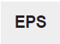

# Kia Sportage: Luz de advertência do sistema de direção assistida elétrica (EPS)

[Início](../../index.md) / [Manual do proprietário do Kia Sportage SL](../sportage-1236.md) / [Características do seu veículo](sportage-1309.md) / [Cluster de instrumentos](sportage-1374.md) / [Advertências e indicadores](sportage-1382.md) / Luz de advertência do sistema de direção assistida elétrica (EPS)

Esta luz de advertência acende-se após a chave do ignição ser girada para a posição ON e, em seguida, apaga-se após o motor ser ligado.

Esta luz também acende-se quando o sistema EPS apresenta algum problema. Se acender durante a condução, leve seu veículo a um concessionário autorizado da Kia para inspeção.
